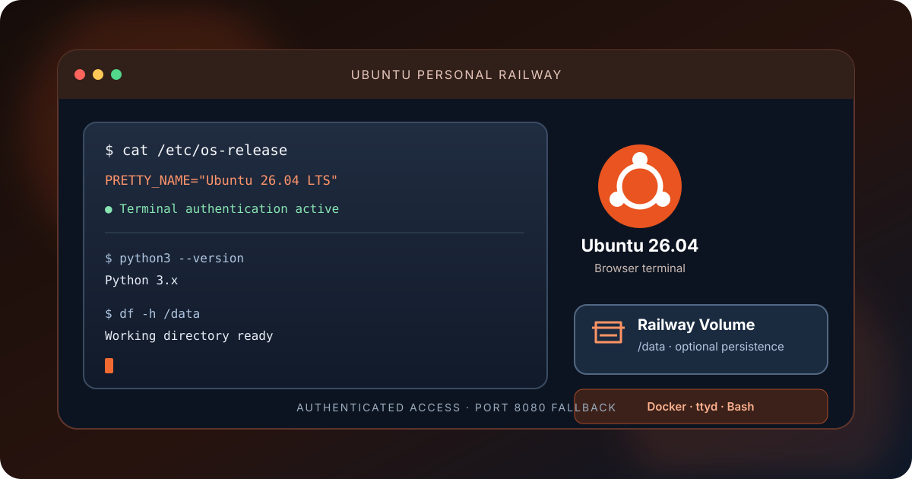
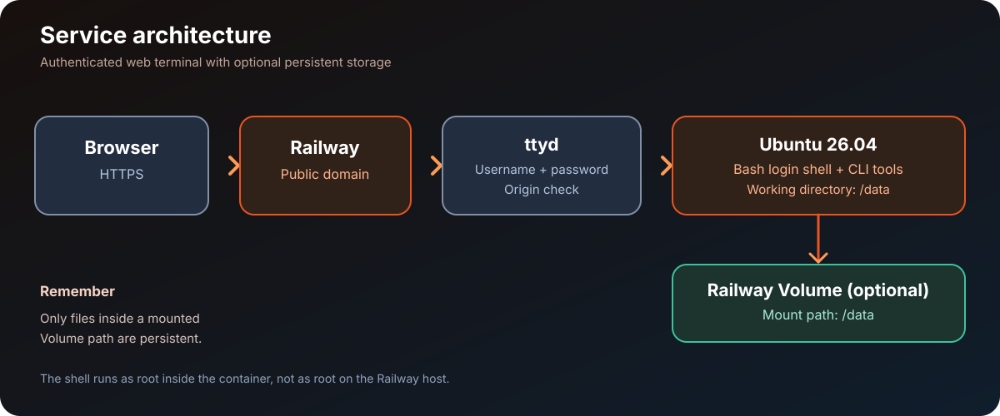

# Ubuntu Personal Railway

  
  
  
  
  

<a href="README.md">🇮🇩 Bahasa Indonesia</a> · <a href="README.en.md">🇬🇧 English</a>

<strong>Ubuntu 26.04 terminal in your browser, ready to deploy on Railway.</strong> 
Access a shell through ttyd, use common CLI tools, and keep important files in a Railway Volume.

  <a href="#quick-start">Quick start</a> ·
  <a href="#features">Features</a> ·
  <a href="#architecture-overview">Architecture</a> ·
  <a href="#deployment-guide">Deployment guide</a> ·
  <a href="#persistent-storage">Storage</a> ·
  <a href="#privacy-and-security">Privacy &amp; security</a> ·
  <a href="#development">Development</a> ·
  <a href="#sources-attribution-and-license">Sources &amp; license</a> ·
  <a href="#contributing">Contributing</a> ·
  <a href="#project-security">Security</a>

---

Original documentation illustration; not an official Ubuntu or Railway screenshot.

> [!WARNING]
> **This is not a full VPS.** Railway runs an application container, not a virtual server with host access, a desktop GUI, or guaranteed full systemd support. The web terminal has root privileges inside the container. Use a strong password and restrict access to the public domain.

## Quick start

1. Open the [Ubuntu Personal Railway repository](https://github.com/DURIAN-ORGANISASI/ubuntu-railway), then choose **New Project → Deploy from GitHub Repo** in Railway.
2. Make sure Railway builds the `Dockerfile` at the repository root.
3. Add `TERMINAL_USER` and `TERMINAL_PASSWORD` under **Railway → Service → Variables**.
4. Deploy, then create a domain under **Settings → Networking → Generate Domain**.
5. Open the domain and sign in. To keep files across redeploys, follow [Persistent storage](#persistent-storage).

## Features

- **Ubuntu 26.04** base image.
- **Browser terminal** powered by `ttyd` with username/password authentication.
- Supports **AMD64 and ARM64** using the matching ttyd binary.
- **Bash login shell** with an automatic system banner when a terminal session opens.
- System information includes OS, kernel, architecture, uptime, CPU, memory, disk, shell, and timezone.
- Common CLI tools: Git, curl, Python 3, pip/venv, compiler/build tools, and shell utilities.
- Default working directory **`/data`**, with optional Railway Volume support.
- Default timezone **`Asia/Jakarta`**.
- WebSocket Origin checking enabled; ttyd logging is configured to suppress NOTICE messages that may include credentials.
- GitHub Actions builds the image and runs a terminal smoke test and credential-log check.

## Architecture overview

1. The browser opens the HTTPS domain provided by Railway.
2. `ttyd` requests a username and password before opening a terminal session.
3. Bash login shell starts and displays the system banner.
4. Commands run inside the Ubuntu container, with `/data` as the initial working directory.
5. An optional Railway Volume mounted at `/data` keeps working files across container recreation.

## Deployment guide

### 1. Deploy on Railway

1. Create or open a Railway project.
2. Select **New Project → Deploy from GitHub Repo**, then choose `DURIAN-ORGANISASI/ubuntu-railway`.
3. Build using the `Dockerfile` at the repository root. A custom Start Command is usually unnecessary because the image defines an `ENTRYPOINT`.
4. Configure the variables below.
5. Wait for the build to finish, then inspect **Build Logs** and **Deploy Logs**.
6. Open **Settings → Networking → Generate Domain**.
7. Visit the domain and sign in when prompted.

### 2. Railway variables

Under **Railway → Service → Variables**, add:

~~~dotenv
TERMINAL_USER=REPLACE_WITH_UNIQUE_USERNAME
TERMINAL_PASSWORD=REPLACE_WITH_RANDOM_PASSWORD_AT_LEAST_24_CHARACTERS
TZ=Asia/Jakarta
~~~

| Variable | Required | Description |
| --- | --- | --- |
| `TERMINAL_USER` | Yes | Login username; must not contain a colon (`:`). |
| `TERMINAL_PASSWORD` | Yes | Unique password, at least 16 characters; 24–40 characters or longer is recommended. |
| `TZ` | No | Timezone; defaults to `Asia/Jakarta`. |
| `PORT` | Automatic | Railway provides it. Do not hardcode it in Variables. The app falls back to 8080 for local use. |

A local example is available in [`.env.example`](.env.example). It is only a template. Never commit a real password. If a password leaks, change `TERMINAL_PASSWORD` in Railway Variables and restart or redeploy the service.

### 3. Use the terminal

After signing in, the terminal opens Bash with `/data` as the working directory. The system banner appears automatically in each new login session.

Example commands:

~~~bash
cat /etc/os-release
python3 --version
git --version
pwd
date
df -h /data
~~~

The shell runs as root **inside the container**, not as root on the Railway host. Git, Python, pip/venv, curl, and compiler tools are included in the image.

### 4. Keep files persistent

Without a Volume, files on the container filesystem are not guaranteed to survive container recreation or redeployment. To persist terminal files:

1. Open **Railway → Service → Settings → Volumes → Add Volume**.
2. Set the **Mount Path** to exactly `/data`.
3. Save files that must persist in `/data`.

Files outside that mount point are not automatically persistent. A Volume is not a backup replacement; copy important files somewhere safe regularly.

## Troubleshooting

| Problem | What to check |
| --- | --- |
| Deployment stops immediately | Set `TERMINAL_USER` without a colon and use a password at least 16 characters long. Check Deploy Logs. |
| Build cannot download ttyd or packages | Check build access to GitHub Releases and Ubuntu package repositories. |
| Domain opens but terminal is missing | Check service status, domain mapping, and the Railway `PORT`. |
| Browser terminal/WebSocket fails | Open the HTTPS domain directly, avoid embedding it from another origin, and inspect runtime logs. |
| Banner is missing | Open a new session and check that an interactive Bash login shell is used. |
| Files disappear after redeploy | Mount a Volume at `/data` and store the files there. |
| Password needs to change | Update `TERMINAL_PASSWORD` in Railway Variables, then restart or redeploy the service. |

## Privacy and security

- **Protect the public domain.** A strong password is required; consider a trusted access gateway if the terminal holds sensitive data.
- **Root shell inside the container.** Commands have high privileges in the container. Review commands carefully; this is not host-root access.
- **Credentials.** Never store passwords, API keys, bot tokens, or private configuration in the repository, screenshots, or public logs.
- **ttyd logs.** The image runs ttyd at debug level 3 to suppress NOTICE messages that may include a credential field. ERROR/WARN messages remain enabled; this is not a complete security guarantee.
- **WebSocket Origin.** `--check-origin` restricts WebSocket connections from mismatched browser origins but does not replace authentication.
- **Volumes.** Only data under a mounted path persists according to the Volume configuration. Protect access to the project and backups.
- **Platform limits.** Full systemd, Docker-in-Docker, host-kernel access, desktop GUI, and all traditional daemons are not guaranteed.
- **Upstream dependencies.** Builds need network access to the Ubuntu base image, GitHub Releases, and package repositories.

## Development

Clone the repository and build the image locally:

~~~bash
git clone https://github.com/DURIAN-ORGANISASI/ubuntu-railway.git
cd ubuntu-railway
docker build --tag ubuntu-personal-railway .
~~~

GitHub Actions builds the Docker image and runs a runtime smoke test. It checks that authenticated terminal access works and that logs do not contain the test password or its Base64 form. These checks do not prove that a live Railway deployment is successful.

### Repository structure

~~~text
ubuntu-railway/
├── Dockerfile
├── entrypoint.sh
├── system-banner.sh
├── .dockerignore
├── .gitignore
├── .env.example
├── LICENSE
├── README.md
├── README.en.md
├── CONTRIBUTING.md
├── SECURITY.md
├── docs/
│   ├── hero.id.svg
│   ├── hero.en.svg
│   ├── architecture.svg
│   ├── architecture.en.svg
│   └── SOURCES.md
└── .github/
    └── workflows/
        └── docker-build.yml
~~~

## Sources, attribution, and license

Upstream sources, illustration attribution, and license scope are documented in [`docs/SOURCES.md`](docs/SOURCES.md).

- **This repository:** [MIT License](LICENSE) covers project materials within its scope.
- **Ubuntu:** the Ubuntu name and logo belong to Canonical. The logo is used to identify the project's base image and does not imply official endorsement.
- **ttyd:** the web terminal binary comes from [tsl0922/ttyd](https://github.com/tsl0922/ttyd) and remains subject to its upstream license.
- **Railway and Docker:** their services and trademarks belong to their respective owners.
- System dependencies and third-party packages remain subject to their own licenses; the repository's MIT license does not override upstream licenses.

## Contributing

Issues and Pull Requests are welcome. Read [`CONTRIBUTING.md`](CONTRIBUTING.md) before proposing changes. Do not include passwords, tokens, API keys, or logs containing secrets.

## Project security

For potential vulnerability reports, follow [`SECURITY.md`](SECURITY.md). Avoid publicly disclosing private domain details, terminal passwords, or deployment credentials.

## License

Project materials covered by the repository are released under the [MIT License](LICENSE). Ubuntu, ttyd, system dependencies, Railway, and third-party services remain subject to their respective terms.

---

  Ubuntu Personal Railway — a practical Ubuntu terminal with browser access and optional persistent storage.

