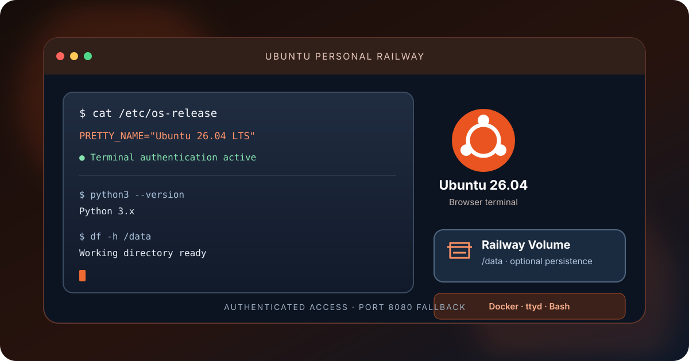
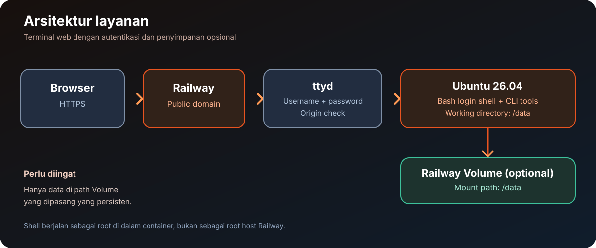

# Ubuntu Personal Railway

  
  
  
  
  

<a href="README.md">🇮🇩 Bahasa Indonesia</a> · <a href="README.en.md">🇬🇧 English</a>

<strong>Terminal Ubuntu 26.04 melalui browser, siap di-deploy ke Railway.</strong> 
Akses shell lewat ttyd, gunakan tool CLI umum, dan simpan file penting pada Railway Volume.

  <a href="#coba-sekarang">Mulai cepat</a> ·
  <a href="#fitur">Fitur</a> ·
  <a href="#arsitektur-singkat">Arsitektur</a> ·
  <a href="#cara-pakai">Panduan penggunaan</a> ·
  <a href="#volume-persisten">Penyimpanan</a> ·
  <a href="#privasi-dan-keamanan">Privasi &amp; keamanan</a> ·
  <a href="#pengembangan">Pengembangan</a> ·
  <a href="#sumber-atribusi-dan-lisensi">Sumber &amp; lisensi</a> ·
  <a href="#kontribusi">Kontribusi</a> ·
  <a href="#keamanan-proyek">Keamanan</a>

---

Ilustrasi orisinal untuk dokumentasi; bukan screenshot resmi Ubuntu atau Railway.

> [!WARNING]
> **Bukan VPS penuh.** Railway menjalankan container aplikasi, bukan server virtual dengan akses ke host, desktop GUI, atau jaminan systemd penuh. Terminal web memiliki akses shell sebagai root di dalam container. Gunakan password kuat dan batasi akses ke domain publik.

## Coba sekarang

1. Buka [repository Ubuntu Personal Railway](https://github.com/DURIAN-ORGANISASI/ubuntu-railway), lalu deploy melalui Railway dengan memilih **New Project → Deploy from GitHub Repo**.
2. Pastikan Railway menggunakan `Dockerfile` di root repository.
3. Tambahkan `TERMINAL_USER` dan `TERMINAL_PASSWORD` pada **Railway → Service → Variables**.
4. Deploy service, lalu buat domain melalui **Settings → Networking → Generate Domain**.
5. Buka domain dan login menggunakan kredensial yang kamu tetapkan. Untuk menyimpan file melewati redeploy, ikuti bagian [Volume persisten](#volume-persisten).

## Fitur

- **Ubuntu 26.04** sebagai image dasar.
- **Terminal browser** menggunakan `ttyd` dengan autentikasi username/password.
- Mendukung arsitektur **AMD64 dan ARM64** melalui binary ttyd yang sesuai.
- **Bash login shell** dengan banner sistem otomatis ketika sesi terminal dibuka.
- Informasi sistem meliputi OS, kernel, arsitektur, uptime, CPU, RAM, disk, shell, dan timezone.
- Tool CLI umum: Git, curl, Python 3, pip/venv, compiler/build tools, dan utilitas shell.
- Direktori kerja default **`/data`**, dengan dukungan Railway Volume opsional.
- Zona waktu default **`Asia/Jakarta`**.
- Pemeriksaan origin WebSocket aktif dan konfigurasi log ttyd menekan pesan NOTICE yang dapat memuat kredensial.
- GitHub Actions membangun image serta menjalankan smoke test terminal dan pemeriksaan kredensial pada log.

## Arsitektur singkat

Alur sederhananya:

1. Browser membuka domain HTTPS yang disediakan Railway.
2. `ttyd` meminta username/password sebelum membuka sesi terminal.
3. Bash login shell memulai sesi dan menampilkan banner sistem.
4. Perintah berjalan di dalam container Ubuntu, dengan direktori kerja awal `/data`.
5. Railway Volume opsional dipasang ke `/data` agar file kerja tersimpan melewati pembuatan ulang container.

## Cara pakai

### 1. Deploy ke Railway

1. Buat atau buka project Railway.
2. Pilih **New Project → Deploy from GitHub Repo**, lalu pilih `DURIAN-ORGANISASI/ubuntu-railway`.
3. Pastikan build menggunakan `Dockerfile` di root repository. Image sudah memiliki `ENTRYPOINT`, sehingga Start Command khusus biasanya tidak diperlukan.
4. Atur variabel pada bagian di bawah.
5. Tunggu build selesai dan periksa **Build Logs** serta **Deploy Logs**.
6. Buka **Settings → Networking → Generate Domain**.
7. Kunjungi domain dan login saat browser meminta autentikasi.

### 2. Variabel Railway

Buka **Railway → Service → Variables**, kemudian tambahkan:

~~~dotenv
TERMINAL_USER=GANTI_DENGAN_USERNAME_UNIK
TERMINAL_PASSWORD=GANTI_DENGAN_PASSWORD_ACAK_MINIMAL_24_KARAKTER
TZ=Asia/Jakarta
~~~

| Variabel | Wajib | Keterangan |
| --- | --- | --- |
| `TERMINAL_USER` | Ya | Username login; tidak boleh mengandung titik dua (`:`). |
| `TERMINAL_PASSWORD` | Ya | Password unik minimal 16 karakter; 24–40 karakter atau lebih disarankan. |
| `TZ` | Tidak | Zona waktu; default `Asia/Jakarta`. |
| `PORT` | Otomatis | Railway menyediakannya. Jangan hardcode di Variables. Aplikasi menggunakan 8080 sebagai fallback lokal. |

Contoh lokal tersedia di [`.env.example`](.env.example). File tersebut hanya template. Jangan pernah menaruh password asli pada repository. Jika password bocor, ubah `TERMINAL_PASSWORD` di Railway Variables lalu restart atau redeploy service.

### 3. Menggunakan terminal

Setelah login, kamu akan masuk ke Bash dengan direktori kerja awal `/data`. Banner sistem muncul otomatis pada sesi login baru.

Contoh perintah:

~~~bash
cat /etc/os-release
python3 --version
git --version
pwd
date
df -h /data
~~~

Shell berjalan sebagai root **di dalam container**, bukan root pada host Railway. Tool seperti Git, Python, pip/venv, curl, dan compiler telah disediakan oleh image.

## Volume persisten

Secara default, filesystem container tidak dijamin bertahan setelah container dibuat ulang atau service di-redeploy. Untuk menyimpan file kerja:

1. Buka **Railway → Service → Settings → Volumes → Add Volume**.
2. Tetapkan **Mount Path** tepat ke `/data`.
3. Simpan file yang perlu dipertahankan di `/data`.

File yang disimpan di luar mount point tidak otomatis persisten. Volume juga bukan pengganti backup; salin file penting ke lokasi aman secara berkala.

## Troubleshooting

| Masalah | Yang perlu diperiksa |
| --- | --- |
| Deployment langsung berhenti | Pastikan `TERMINAL_USER` diisi dan tidak mengandung `:`; password harus minimal 16 karakter. Periksa Deploy Logs. |
| Build gagal mengunduh ttyd atau paket | Periksa akses build ke GitHub Releases dan repository paket Ubuntu. |
| Domain terbuka tetapi terminal tidak tampil | Pastikan service aktif, domain mengarah ke service yang benar, dan aplikasi mendengarkan pada `PORT` Railway. |
| Terminal/WebSocket gagal di browser | Buka domain HTTPS langsung, jangan embed dari origin lain, dan periksa runtime logs. |
| Banner tidak muncul | Buka sesi terminal baru dan pastikan shell yang berjalan adalah Bash login interaktif. |
| File hilang setelah redeploy | Pasang Volume tepat di `/data` dan pastikan file berada di dalam direktori itu. |
| Perlu mengganti password | Ubah `TERMINAL_PASSWORD` di Railway Variables, lalu restart atau redeploy service. |

## Privasi dan keamanan

- **Lindungi domain publik.** Password kuat wajib; pertimbangkan access gateway tepercaya jika terminal menyimpan data sensitif.
- **Shell root dalam container.** Perintah memiliki hak tinggi di container, jadi periksa perintah sebelum menjalankannya. Akses ke container bukan akses root ke host Railway.
- **Kredensial.** Jangan menyimpan password, API key, token bot, atau konfigurasi rahasia di repository, screenshot, maupun log publik.
- **Log ttyd.** Image menjalankan ttyd pada debug level 3 untuk menekan NOTICE yang bisa menyertakan field kredensial. Level ERROR/WARN tetap aktif; ini bukan jaminan keamanan menyeluruh.
- **Origin WebSocket.** Opsi `--check-origin` membatasi koneksi WebSocket dari origin browser yang tidak sesuai, tetapi tidak menggantikan autentikasi.
- **Volume.** Hanya data di path mount yang dijamin persisten oleh konfigurasi Volume. Lindungi akses ke project dan backup.
- **Batas platform.** systemd penuh, Docker-in-Docker, akses kernel host, desktop GUI, dan semua daemon tradisional tidak dijamin tersedia.
- **Upstream.** Build membutuhkan akses jaringan ke base image Ubuntu, GitHub Releases, dan repositori paket. Ketersediaan sumber upstream dapat berubah.

## Pengembangan

Clone repository dan bangun image secara lokal:

~~~bash
git clone https://github.com/DURIAN-ORGANISASI/ubuntu-railway.git
cd ubuntu-railway
docker build --tag ubuntu-personal-railway .
~~~

GitHub Actions menjalankan build Docker dan smoke test runtime. Workflow memeriksa apakah terminal merespons dengan autentikasi dan memastikan log tidak berisi password pengujian maupun bentuk Base64-nya. Pemeriksaan ini tidak membuktikan deployment Railway live sudah berhasil.

### Struktur repository

~~~text
ubuntu-railway/
├── Dockerfile
├── entrypoint.sh
├── system-banner.sh
├── .dockerignore
├── .gitignore
├── .env.example
├── LICENSE
├── README.md
├── README.en.md
├── CONTRIBUTING.md
├── SECURITY.md
├── docs/
│   ├── hero.id.svg
│   ├── hero.en.svg
│   ├── architecture.svg
│   ├── architecture.en.svg
│   └── SOURCES.md
└── .github/
    └── workflows/
        └── docker-build.yml
~~~

## Sumber, atribusi, dan lisensi

Sumber upstream, atribut ilustrasi, dan cakupan lisensi dijelaskan dalam [`docs/SOURCES.md`](docs/SOURCES.md).

- **Repository ini:** menggunakan [MIT License](LICENSE) untuk materi proyek yang tercakup.
- **Ubuntu:** nama dan logo Ubuntu dimiliki oleh Canonical; penggunaan logo di README bertujuan mengidentifikasi image dasar proyek dan tidak menyiratkan dukungan resmi.
- **ttyd:** binary terminal web berasal dari [tsl0922/ttyd](https://github.com/tsl0922/ttyd) dan tunduk pada lisensi upstream-nya.
- **Railway dan Docker:** layanan serta merek dagangnya tetap milik pemilik masing-masing.
- Dependensi sistem dan paket pihak ketiga tunduk pada lisensi masing-masing; MIT pada repository ini tidak mengubah lisensi upstream.

## Kontribusi

Kontribusi melalui Issues dan Pull Requests dipersilakan. Baca [`CONTRIBUTING.md`](CONTRIBUTING.md) sebelum mengajukan perubahan. Jangan sertakan password, token, API key, atau log yang memuat rahasia.

## Keamanan proyek

Untuk pelaporan potensi kerentanan, ikuti [`SECURITY.md`](SECURITY.md). Hindari memublikasikan detail akses domain privat, password terminal, atau kredensial deployment.

## Lisensi

Materi proyek yang tercakup dirilis di bawah [MIT License](LICENSE). Ketentuan untuk Ubuntu, ttyd, dependensi sistem, Railway, dan layanan pihak ketiga berlaku secara terpisah.

---

  Ubuntu Personal Railway — terminal Ubuntu yang praktis, dengan akses browser dan penyimpanan opsional.

